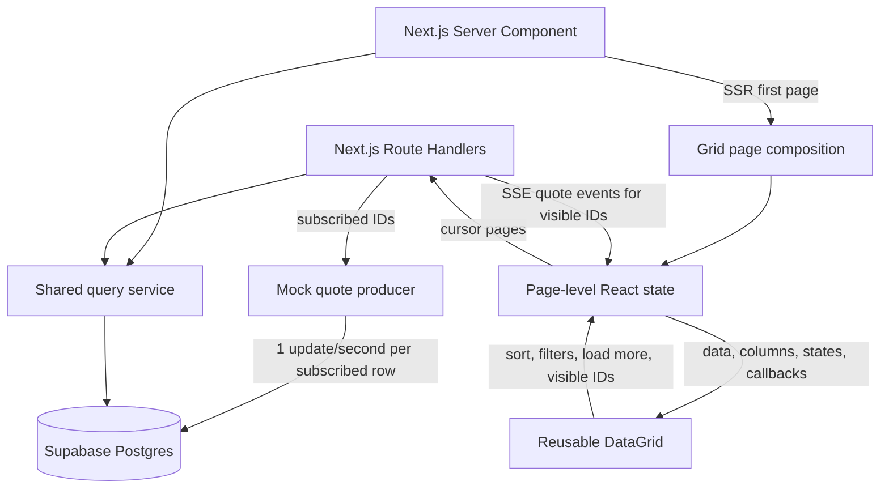

# Reusable live data grid — design

Date: October 21, 2026  
Status: Finalized for the first implementation phase. Revised October 21, 2026 to replace viewport polling with Server-Sent Events (section 2.1).

## 1. Purpose and scope

Build a reusable React and TypeScript data grid, demonstrated in a Next.js application backed by Supabase Postgres. The project should demonstrate reusable component boundaries, accessibility, responsive behavior, and stable performance while displaying a large, changing dataset.

The database may contain **50,000** or more records, while the browser loads only discovered pages and the DOM mounts only the rows near the viewport.

### Assumptions

- **Read-only cells.** The first version has no cell editing. Enter and Space activate focused controls such as sortable headers.
- **One flat bond schema.** Each bond contains `id`, `isin`, `cusip`, `ticker`, `issuer`, `sector`, `creditRating`, `maturity`, `bid`, and `ask`. Nested fields and arrays are deferred.
- **Ratings are display strings.** Values such as `AA` and `A+` do not identify Moody's, S&P, or another agency. Agency-aware rating objects and semantic rating sorting are deferred.
- **Complete synthetic records.** Seeded bonds contain every agreed field. Nullability and real identifier checksum validation are outside the first version.
- **Supabase is the source of truth.** A separate mock producer updates quote values directly in Supabase. Initial page requests, pagination, sorting, filtering, and quote updates all read the same current database state through Next.js.
- **The producer follows the audience.** It updates every subscribed bond once per second and a small background share of the rest of the dataset. It changes `bid` and `ask` together, preserves descriptive fields, and maintains `ask >= bid`. It does not insert or delete bonds. Every update is persisted before it is pushed.
- **Viewport subscription.** The browser subscribes to the current values of up to 50 displayed bond IDs over one Server-Sent Events stream and receives at most one conflated update per bond per second. The current-rows endpoint remains for the initial snapshot and as a polling fallback.
- **Maturity is a calendar date.** Store it as a Postgres `date` and transport it as `YYYY-MM-DD`.
- **Shared schema, different views.** Clients use the same bond shape but may request and display different fields.
- **Mobile-first layout.** The grid must work from a 320px-wide viewport upward.
- **Storybook is isolated.** Ordinary stories use a small deterministic client-side fixture and do not require Supabase or the Next.js server.

### Requirement interpretation

| Requirement          | First-version behavior                                                      |
| -------------------- | --------------------------------------------------------------------------- |
| Dataset              | Seed 50,000 bonds; consider 100,000 only as a later benchmark.              |
| Updates              | Producer writes one quote update per second for each subscribed bond, plus a low background rate, to Supabase. |
| Client freshness     | Subscribe to the visible IDs over SSE through Next.js; conflate to one event per bond per second. |
| Public grid contract | Generic `data`, `columns`, identity, state, and callback props.             |
| Pagination           | Cursor pagination with 100 records per page.                                |
| Infinite scroll      | Load six additional pages automatically, then require the Load more button. |
| Rendering            | Virtualized rows with a sticky header and sticky first column.              |
| Sorting              | Server-side ascending or descending sorting with a stable snapshot order.   |
| Filtering            | Server-side CUSIP, ticker, sector, and credit-rating filters.               |
| Responsive behavior  | Preserve readable widths and use horizontal scrolling on narrow containers. |
| Keyboard             | Arrow keys, Tab/Shift+Tab, Enter, and Space.                                |

Initial exclusions are editing, selection, bulk actions, grouping, export, historical charts, live insertion or deletion, and continuously reordering rows as quotes change.

## 2. Design decisions

### 2.1 Database-backed mock updates pushed over Server-Sent Events

The mock producer is a separate backend process under our control. It generates valid bid/ask changes and writes them to Supabase. Supabase remains the only authority for both initial and current values, which avoids reconciliation between a database baseline and a separate in-memory stream.

The Next.js application owns all browser-facing APIs. The browser opens one Server-Sent Events stream for the bond IDs currently displayed in the viewport. When the viewport changes, the browser closes the stream and opens a new one for the new ID set; up to 50 IDs fit in the request URL. The server emits the latest persisted row for each subscribed bond at most once per second (conflation), so a bond that changed several times within a second produces one event carrying its current state.

This mirrors how consumer quote pages such as Yahoo Finance work: the client subscribes to the symbols on screen, the server conflates the upstream feed to roughly one update per symbol per second, and the pushed value is the same one a reload would fetch.

The original first version used one-second polling of the visible IDs against a producer that updated 50 random rows per second across the whole dataset. That design was correct but unobservable: with 25 rows on screen, a visible row changed about once every 40 seconds. Producer updates are now concentrated on subscribed rows (section 4.4) so every displayed quote moves each second while the rest of the dataset drifts slowly.

| Option                                | Decision | Trade-off                                                                                                                                 |
| ------------------------------------- | -------- | ----------------------------------------------------------------------------------------------------------------------------------------- |
| Server-Sent Events through Next.js    | Selected | One-way push over plain HTTP; `EventSource` reconnects automatically; a Next.js route handler can return a streaming response. Long-lived connections are capped on serverless hosts, so the client must tolerate reconnects. |
| Client polling through Next.js        | Fallback | Simple lifecycle and already implemented; kept for the first snapshot and when `EventSource` is unavailable or the stream fails repeatedly. |
| Client-side simulator                 | Rejected | Invents values the database never had, so scrolling, sorting, and reloading disagree with what was displayed. Reintroduces the two-sources-of-truth problem. |
| Supabase Realtime                     | Deferred | Would replace the producer-to-server hop but adds subscription fan-out the demo does not need yet.                                        |
| WebSocket                             | Deferred | Supports two-way communication that read-only cells do not require, and Next.js route handlers cannot upgrade connections without a custom server. |

Apply a pushed row only when its database `version` is newer than the displayed version. A reconnect replays nothing; the client requests the current rows once after reconnecting so a gap cannot leave stale quotes on screen.

### 2.2 Hybrid infinite scroll with cursor pagination

The initial request returns 100 records. Scrolling near the end automatically loads six additional pages. After that, one Load more button press loads one page at a time so the page footer remains reachable. Changing the sort or filters creates a new query and resets the automatic-load count.

Use an opaque cursor tied to a stable query snapshot. Offset pagination is excluded because large offsets become increasingly expensive and mutable sort fields can cause skipped or repeated rows. The record ID is always the final sort tie-breaker. [PostgreSQL LIMIT/OFFSET guidance](https://www.postgresql.org/docs/current/queries-limit.html)

Row virtualization is independent of pagination: loaded records may remain in memory or cache while only viewport-adjacent rows are mounted.

### 2.3 shadcn/ui and TanStack

Use shadcn/ui for visual primitives, TanStack Table for table state, and TanStack Virtual for row virtualization.

shadcn/ui provides composable source code and styling rather than a complete high-throughput grid. TanStack supplies headless sorting and column-sizing behavior, including initial, minimum, and maximum sizes through `size`, `minSize`, and `maxSize`. [shadcn data table](https://ui.shadcn.com/docs/components/radix/data-table), [TanStack column sizing](https://tanstack.com/table/latest/docs/framework/react/guide/column-sizing), [TanStack Virtual](https://tanstack.com/virtual/latest/docs/introduction). Even though we could use Tailwindcss to make the `maxWidth` work, it could create conflict with HeroUI's style.

#### Alternatives

**HeroUI.** HeroUI provides accessible table composition, virtualization, sorting, and resizing. Its current documented column props include `defaultWidth` and `minWidth`, but do not expose a documented `maxWidth`, so the TanStack sizing model fits this contract more directly. [HeroUI Table](https://heroui.com/en/docs/react/components/table)

**Custom HTML table.** A handwritten semantic table offers complete rendering control and no table-library conventions. It would also make this project responsible for all resizing, sorting state, virtualization integration, and accessibility behavior.

### 2.4 REST API

Use REST with an allowlisted field projection. Different clients selecting different fields from the same flat bond schema do not require GraphQL.

GraphQL can be reconsidered if clients later need different nested relationships, related entities, or an established GraphQL ecosystem.

### 2.5 Sorting while values change

Create an ordered snapshot of matching bond IDs when a query begins. Cursor pages traverse that immutable order, while the quote stream overlays the latest database values for the visible rows. Rows do not move while the user is reading them.

Changing the sort creates a new snapshot, keeps the previous rows dimmed behind an "Updating rows" status until the first page arrives, then replaces them and returns to the top. The alternative is to sort each requested page independently against current values, which can create duplicates or omissions when quotes change between requests, so it is excluded.

## 3. High-level architecture



### Responsibilities

#### Backend

- **Next.js Server Component:** reads the first page through the shared query service and renders the Suspense fallback while it loads.
- **Next.js Route Handlers:** own the browser-facing query, pagination, filtering, sorting, current-row, and quote-stream endpoints.
- **Shared query service:** validates inputs and performs Supabase reads without requiring the Server Component to call its own HTTP endpoint.
- **Mock producer:** changes every subscribed bond quote once per second, plus a low background rate across the dataset, and persists each change to Supabase before it is pushed.

#### Database

- **Supabase Postgres:** stores the 50,000 bonds, current quotes, row versions, update timestamps, and stable order snapshots.

#### Frontend

- **Page-level React state:** a page-specific hook or component owns fetched pages, the current sort and filters, the quote stream subscription for the visible IDs, and loading/error state. Use Context only if the toolbar and grid become distant descendants that otherwise require excessive prop passing.
- **DataGrid:** renders the supplied rows and owns grid-local behavior such as focus, column widths, sticky positioning, virtualization, and a brief flash on cells whose value changed since the row was last shown. It has no Supabase or Next.js dependency.
- **Toolbar:** provides the text input with placeholder “search CUSIP or ticker” and optional sector and rating filters. Filter state is reflected in the URL query string and sent to the backend.

## 4. Data model

### 4.1 Bond fields

Use the same flat model in Supabase, API responses, local fixtures, and the application.

| Field          | Frontend / JSON     | Postgres           | Constraints                                                           |
| -------------- | ------------------- | ------------------ | --------------------------------------------------------------------- |
| `id`           | `string`            | `uuid`             | Primary key and stable row identity.                                  |
| `isin`         | `string`            | `text`             | Exactly 12 uppercase alphanumeric characters for the prototype.       |
| `cusip`        | `string`            | `text`             | Exactly 9 uppercase alphanumeric characters; preserve leading zeroes. |
| `ticker`       | `string`            | `text`             | Trimmed, 1–32 characters.                                             |
| `issuer`       | `string`            | `text`             | Trimmed, 1–200 characters.                                            |
| `sector`       | `BondSector`        | constrained `text` | One of the six agreed codes.                                          |
| `creditRating` | `string`            | `text`             | Trimmed, 1–16 characters; agency is unspecified.                      |
| `maturity`     | `YYYY-MM-DD` string | `date`             | Valid calendar date with no timezone conversion.                      |
| `bid`          | `number`            | `numeric(12,4)`    | Finite and nonnegative.                                               |
| `ask`          | `number`            | `numeric(12,4)`    | Finite, nonnegative, and greater than or equal to bid.                |

`BondSector` is the closed union `"Muni" | "corp" | "agency" | "trea" | "MBS" | "ABS"`. Display labels are Municipal, Corporate, Agency, Treasury, Mortgage-backed securities, and Asset-backed securities.

Use snake_case in SQL and camelCase in JSON. Validate the domain shape when data enters the application. Rating sorting remains disabled because `creditRating` is display text rather than a normalized scale.

### 4.2 Synchronization metadata

Supabase owns the current row and its synchronization metadata.

| Field        | Postgres type | Purpose                                                      |
| ------------ | ------------- | ------------------------------------------------------------ |
| `version`    | `bigint`      | Incremented atomically whenever the producer updates a bond. |
| `updated_at` | `timestamptz` | Records when the producer committed the current quote.       |

The API exposes these as `version` and `updatedAt`, serializing the bigint version as a decimal string. The grid component does not interpret them; the page-level stream and polling logic compares versions numerically and rejects an older or duplicate event. A producer update changes bid, ask, version, and updated_at in one database statement.

Start with indexes on `id`, `cusip`, `ticker`, and `(ticker, id)`. Add indexes for demonstrated filter and sort combinations after inspecting actual query plans.

### 4.3 Order snapshot tables

| Table                   | Core fields                                                                                           | Purpose                                                          |
| ----------------------- | ----------------------------------------------------------------------------------------------------- | ---------------------------------------------------------------- |
| `grid_snapshots`        | `id`, `query_hash`, `sort_definition`, `filter_definition`, `created_at`, `expires_at`, `total_count` | Describes one stable filtered order.                             |
| `grid_snapshot_entries` | `snapshot_id`, `ordinal`, `record_id`                                                                 | Stores ordered membership; primary key `(snapshot_id, ordinal)`. |

Create the ordered entries from one consistent database transaction, with `id` as the final tie-breaker. Page reads seek by ordinal within the snapshot:
`snapshot_id = ? AND ordinal > ? ORDER BY ordinal LIMIT 100`.

A starting snapshot lifetime of 15 minutes is sufficient for the demo. Expired snapshots are deleted by scheduled cleanup. At 50,000 rows, snapshot creation and storage must be benchmarked because each new sort or filter stores 50,000 ordered identities in the worst case.

### 4.4 Mock quote producer

The producer runs independently of browser requests but follows the audience. Each second it updates every bond that any open stream subscribes to, plus a small background sample of unsubscribed bonds (initially 10 per second) so sorted orders still drift over time. Each update changes bid and ask together, preserves a valid spread, and is persisted to Supabase in one statement before the stream tier reads it.

The stream tier tells the producer which IDs are subscribed. With the in-memory store both run in the Next.js server process and share an in-memory subscription registry. With Supabase, each server process publishes its subscribed IDs to `grid_subscriptions` with a five-second heartbeat, and the producer (`scripts/producer.ts`) reads the union of IDs reported within the last 15 seconds through `subscribed_bond_ids()`, draws its background sample with `random_bond_ids()`, and writes through `apply_quote_updates()`. The stream tier learns of changes by reading the subscribed rows once per second and comparing versions.

Batch the per-second updates when practical and measure database write latency. A producer restart resumes from the current database rows; durable quote history is outside the first version.

## 5. API contract

Next.js is the only browser-facing API owner. All routes use the `/api/v1/grid` prefix, validate projections, filters, sorting, cursor integrity, body size, and cancellation, and return `Cache-Control: private, no-store` for quote-bearing responses.

### 5.1 Create a paginated query

`POST /api/v1/grid/queries`

```json
{
  "fields": [
    "isin",
    "cusip",
    "ticker",
    "issuer",
    "sector",
    "creditRating",
    "maturity",
    "bid",
    "ask"
  ],
  "filters": {
    "cusip": "",
    "ticker": "UST",
    "sector": ["trea"],
    "creditRating": ["AAA", "AA+"]
  },
  "sort": {
    "field": "ticker",
    "direction": "asc"
  },
  "pageSize": 100
}
```

`cusip` and `ticker` are optional case-insensitive prefix filters. When both are populated, a record may match either identifier; the toolbar can therefore send its single search value to both fields. Values within the sector and rating arrays use OR semantics, while the identifier, sector, and rating groups combine with AND. Empty values are omitted during normalization.

Example response:

```json
{
  "snapshotId": "a0a00000-0000-4000-8000-000000000001",
  "queryFingerprint": "opaque-query-fingerprint",
  "expiresAt": "2026-10-21T14:15:00Z",
  "sort": {
    "field": "ticker",
    "direction": "asc"
  },
  "filters": {
    "ticker": "UST",
    "sector": ["trea"],
    "creditRating": ["AAA", "AA+"]
  },
  "fields": [
    "isin",
    "cusip",
    "ticker",
    "issuer",
    "sector",
    "creditRating",
    "maturity",
    "bid",
    "ask"
  ],
  "pageSize": 100,
  "totalCount": 1250,
  "rows": [
    {
      "id": "b0a00000-0000-4000-8000-000000000042",
      "isin": "US123456AB78",
      "cusip": "123456AB7",
      "ticker": "UST",
      "issuer": "United States Treasury",
      "sector": "trea",
      "creditRating": "AAA",
      "maturity": "2035-06-15",
      "bid": 99.125,
      "ask": 99.175,
      "version": "19",
      "updatedAt": "2026-10-21T14:00:00.020Z"
    }
  ],
  "nextCursor": "opaque-signed-cursor",
  "hasMore": true
}
```

The rows array is shortened. Default order is `ticker asc, id asc`; default page size is 100 and the maximum is 500. Accept one sortable field and always append `id` as the stable tie-breaker. The cursor binds the snapshot, query fingerprint, last ordinal, and expiry.

### 5.2 Fetch another page

`GET /api/v1/grid/queries/{snapshotId}/rows?after={cursor}`

Return the same page envelope with the next 100 rows. Validate the signed cursor and query scope. A missing, modified, or expired cursor returns a structured error instead of silently starting another order.

### 5.3 Fetch current visible rows

`POST /api/v1/grid/rows/current`

```json
{
  "rowIds": [
    "b0a00000-0000-4000-8000-000000000042",
    "b0a00000-0000-4000-8000-000000000043"
  ]
}
```

Accept 1–50 distinct IDs and return each complete current bond record, including `version` and `updatedAt`, regardless of the visible column set. The browser calls this endpoint once when a stream connects or reconnects, and once per second as a fallback when `EventSource` is unavailable.

### 5.4 Subscribe to visible rows

`GET /api/v1/grid/rows/stream?ids={id1},{id2},...`

Accept 1–50 distinct IDs and respond with `Content-Type: text/event-stream`, `Cache-Control: private, no-store`, and `Connection: keep-alive`. The stream emits:

```text
event: quotes
id: 1729519200-7
data: {"rows":[{"id":"b0a00000-0000-4000-8000-000000000042","bid":99.125,"ask":99.175,"version":"20","updatedAt":"2026-10-21T14:00:01.004Z"}]}

: heartbeat
```

One `quotes` event per second carries every subscribed bond that changed in that second, with its complete current record. Rows that did not change are omitted. A comment heartbeat is sent every 15 seconds so proxies keep the connection open. A viewport change replaces the subscription by closing the stream and opening a new one. The server releases the subscription when the request is aborted, and the hot set drops IDs that no open stream references.

### 5.5 Error semantics

Use the envelope `{ "error": { "code": "...", "message": "...", "retryable": true }, "requestId": "..." }`.

| Status        | Example                                                            | Client behavior                                                                             |
| ------------- | ------------------------------------------------------------------ | ------------------------------------------------------------------------------------------- |
| 400           | Invalid projection, filter, sort, cursor, or more than 50 row IDs | Show the configuration or input error.                                                      |
| 401 / 403     | Missing session or denied access                                   | Stop requests and show the access state.                                                    |
| 410           | `SNAPSHOT_EXPIRED`                                                 | Keep displayed rows and require a new query.                                                |
| 429           | Query, stream, or polling rate exceeded                                     | Respect `Retry-After` and retain existing rows.                                             |
| 503 / network | Database or route temporarily unavailable                          | Retain existing rows and offer Retry for page failures; `EventSource` reconnects on its own, and after three failed reconnects the client falls back to one-second polling. |

### 5.6 Data access

Server Components and Route Handlers use server-side Supabase credentials with the narrowest required role. The browser never receives a service-role key and does not query Supabase directly.

The public synthetic demo may use a restricted anonymous session. Apply the same effective access scope to query creation, later pages, current-row fetches, and the quote stream. If tenants are introduced, derive tenant scope from verified identity and enforce Row Level Security. [Supabase RLS guidance](https://supabase.com/docs/guides/database/postgres/row-level-security)

## 6. Component developer documentation

### 6.1 Basic usage

`DataGrid<T>` displays the row objects supplied through `data` in the order defined by `columns`. The component is generic and does not fetch data or import Next.js or Supabase modules.

### 6.2 Grid props

| Prop         | Type                             | Required | Description                                                                 |
| ------------ | -------------------------------- | -------- | --------------------------------------------------------------------------- |
| `data`       | `readonly T[]`                   | Yes      | Rows currently available to display. The grid never mutates the array.      |
| `columns`    | `readonly ColumnDefinition<T>[]` | Yes      | Ordered visible columns.                                                    |
| `name`       | `string`                         | Yes      | Visible grid title.                                                         |
| `id`         | `string`                         | Yes      | Stable grid and DOM identifier.                                             |
| `style`      | `React.CSSProperties`            | No       | Root style overrides.                                                       |
| `aria-label` | `string`                         | No       | Accessible label when the visible name is insufficient. Defaults to `name`. |

Rows must contain a stable `id` string or number. Array indices are never used as row identity.

### 6.3 Column definitions

Columns reference flat keys from `T`. The visible header defaults to the field key; `aria-label` supplies a clearer accessible label when needed.

| Property     | Type              | Required | Description                       |
| ------------ | ----------------- | -------- | --------------------------------- |
| `key`        | String key of `T` | Yes      | Flat field and column identifier. |
| `width`      | `number`          | Yes      | Initial width in pixels.          |
| `minWidth`   | `number`          | No       | Lower resize boundary.            |
| `maxWidth`   | `number`          | No       | Upper resize boundary.            |
| `aria-label` | `string`          | No       | Accessible header label.          |

The grid owns resized widths locally. New data must not reset a width, and all widths are clamped to the optional minimum and maximum.

### 6.4 Sorting and async states

| Prop           | Type                                          | Default | Description                                          |
| -------------- | --------------------------------------------- | ------- | ---------------------------------------------------- |
| `sort`         | `{ key, direction: "asc" \| "desc" } \| null` | `null`  | Current server sort.                                 |
| `onSortChange` | Callback                                      | None    | Requests ascending or descending order for a column. |
| `isLoading`    | `boolean`                                     | `false` | Shows the loading skeleton.                          |
| `error`        | `Error \| null`                               | `null`  | Shows the error state.                               |
| `hasMore`      | `boolean`                                     | `false` | Indicates whether another cursor page exists.        |
| `onRetry`      | Callback                                      | None    | Retries the failed request.                          |
| `onLoadMore`   | Callback                                      | None    | Requests the next page.                              |

The Supabase-backed demo performs sorting on the server. The grid displays the supplied order and does not sort a partially loaded array.

## 7. Performance

### Virtualization

Use TanStack Virtual with a fixed row height and a bounded scroll container. Mount only the visible rows plus a small overscan, initially 10 rows on each side. Render all configured columns at first; add column virtualization only if profiling shows a need.

### Infinite-scroll cache

Use TanStack Query for cursor pages, cancellation, and loading/error state. Start with a cache budget of roughly 10 pages, or 1,000 rows at the default page size. Retain the viewport and focused rows while evicting distant pages.

Preserve scroll geometry when a page is evicted. Approaching an evicted range refetches it and displays fixed-height placeholders rather than collapsing the scroll position. Refetching an already discovered page does not count toward the six automatic page loads.

The navigable scrollbar represents discovered rows rather than pretending all 50,000 rows support random access. Display the total matching count separately.

## 8. Responsive layout, keyboard, and states

### Responsive and resizing behavior

Use container width as the layout input. At 320px, stack toolbar controls and allow horizontal scrolling without shrinking text below a readable size. Keep CUSIP as the first sticky column and keep the header sticky inside the same scroll container.

Headers and cells share one column-width model. Column resizing supports pointer and keyboard interaction, honors `minWidth` and `maxWidth`, and uses a touch-friendly handle. Truncate long values while providing an accessible way to read the full text.

### Keyboard policy

| Key             | Behavior                                                                                                               |
| --------------- | ---------------------------------------------------------------------------------------------------------------------- |
| Arrow keys      | Move focus by one cell, mounting a virtualized destination before focusing it.                                         |
| Tab / Shift+Tab | Move to the next or previous cell in row-major order and exit the grid at its boundaries.                              |
| Enter / Space   | Activate the focused sortable header, Load more button, or other grid control. Read-only cells do not enter edit mode. |

Do not intercept these keys while the user is operating an embedded control. Expose grid, row, header, and cell semantics with logical indices that remain correct under virtualization.

### UI states

| State                | Presentation                                          |
| -------------------- | ----------------------------------------------------- |
| Initial loading      | Named skeleton region with a busy state.              |
| Empty result         | Clear empty message with no loading sentinel.         |
| Initial failure      | Error message and Retry action.                       |
| Query change         | Keep previous rows dimmed with an "Updating rows" status, then replace them and return to the top. |
| Quote update         | Flash the changed cell in the accent tint for under one second; no row movement. |
| Loading another page | Keep existing rows and show footer progress.          |
| Later-page failure   | Keep existing rows and show Retry at the same cursor. |
| No more rows         | End-of-results footer.                                |

## 9. Storybook

Storybook documents the public props and shows the reusable grid in isolation. Use the Next.js Vite Storybook framework already configured in the project, import the application theme through the preview configuration, and keep Storybook independent of Supabase credentials.

Use the deterministic 20-bond fixture for the default, empty, narrow-container, and loading stories. Stories should help a new developer understand the component contract without requiring the application server or the 50,000-row database seed.

## 10. Validation and portfolio evidence

These are proposed acceptance checks and performance targets rather than benchmark results.

| Area                | Evidence to collect                                                                                                                    |
| ------------------- | -------------------------------------------------------------------------------------------------------------------------------------- |
| Producer throughput | Sustain one valid Supabase update per second for 50 subscribed bonds plus the background rate, and record database write latency.     |
| Push freshness      | Stream up to 50 visible rows and measure producer commit-to-display latency; target p95 below 1.5 seconds. Verify reconnect fetches a snapshot and that polling fallback engages after repeated stream failures. |
| Virtualization      | Mounted rows follow viewport plus overscan rather than loaded or total row count.                                                      |
| Memory              | Traverse the dataset while the resident page cache remains near its configured budget.                                                 |
| Responsiveness      | Target smooth scrolling and no sustained update-driven tasks over 50ms on the reference desktop; profile a mobile viewport separately. |
| Cursor correctness  | Mutate quote fields across page boundaries and verify that a snapshot has no skipped or repeated IDs.                                  |
| Hybrid browsing     | Verify six successful automatic page loads, manual loads afterward, retry behavior, and reset after sort/filter changes.               |
| Accessibility       | Test keyboard traversal and resizing, VoiceOver on macOS, and automated accessibility checks.                                          |
| Reuse               | Render two column configurations with the same grid and no Next.js or Supabase imports in the reusable component.                      |
| Bond schema         | Validate UUIDs, identifier lengths, sector values, maturity dates, rating strings, numeric precision, and valid spreads.               |
| Storybook           | Build without Supabase credentials and render the fixture, empty, narrow, and loading stories.                                         |

Record dataset size, page size, visible and mounted row counts, browser/device, build mode, stream conflation interval, and database latency with each performance result.
